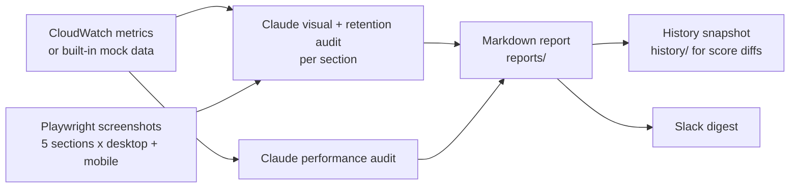

# SiteAudit

A hackathon pipeline that screenshots your website, combines it with speed and behaviour metrics, and has Claude rate each section, explain why visitors drop off, and suggest concrete fixes to improve speed and retention.


<!-- screenshot: add docs/screenshot.png -->

## What it does

- **Screenshots 5 page sections** (above the fold, features, social proof, pricing, footer CTA) on desktop (1280×800) and mobile (390×844).
- **Rates each section 1–10** with Claude vision, using scroll depth, time on section, bounce and CTA click rate as evidence.
- **Audits speed**: turns TTFB (p50/p95/p99), page-load time and 4xx/5xx error rates into user-impact explanations and AWS-level fixes.
- **Writes a Markdown report** with overall, visual and performance scores, a prioritised fix list, and the score change since the last run.
- **Notifies Slack** with the scores and top fixes (optional).
- **Collects real behaviour data** with an optional JS tracker and a Flask endpoint that pushes to CloudWatch.

## How it works



Overall score = average of (mean section score, performance score). Without AWS credentials, SiteAudit uses built-in **mock metrics** (deliberately slow numbers) so the demo still runs.

## Quickstart

Requires Python 3.11+ and an [Anthropic API key](https://console.anthropic.com/).

```bash
git clone https://github.com/0jz/SiteAudit.git && cd SiteAudit
python -m venv .venv && source .venv/bin/activate     # Windows: .venv\Scripts\activate
pip install anthropic playwright requests boto3
playwright install chromium
export ANTHROPIC_API_KEY=<your-anthropic-key> TARGET_URL=<https://your-site.com>   # PowerShell: $env:ANTHROPIC_API_KEY="<key>"; $env:TARGET_URL="<url>"
python main.py
```

The report is written to `reports/audit_<site>_<timestamp>.md`.

> `pyproject.toml` only declares `anthropic` and `daytona`, so the extra packages above are installed by hand. `boto3` is only needed for real CloudWatch data.

## Configuration

Set these as environment variables. No `.env` file is loaded.

| Variable | Required | Default | Description |
|----------|----------|---------|-------------|
| `ANTHROPIC_API_KEY` | Yes (for AI audit) | – | Without it, the Claude steps are skipped and the report has placeholder scores |
| `TARGET_URL` | Yes | `https://example.com` | Site to audit |
| `SITE_NAME` | No | `My Website` | Display name in prompts, report and Slack |
| `AWS_ACCESS_KEY_ID` | No | – | If set, pull real metrics from CloudWatch; otherwise use mock data |
| `AWS_SECRET_ACCESS_KEY` | No | – | CloudWatch credentials |
| `AWS_REGION` | No | `us-east-1` | CloudWatch region |
| `CLOUDWATCH_NAMESPACE` | No | `SiteAudit` | Namespace for custom behaviour metrics |
| `SLACK_WEBHOOK_URL` | No | – | Slack incoming webhook; skipped if unset |

Model (`claude-sonnet-4-20250514`), section scroll positions and score thresholds (critical < 4, warning < 6) are set in `config.py`.

## Usage

| Command | What it does |
|---------|--------------|
| `python main.py` | Full run: metrics, screenshots, Claude audits, report, Slack |
| `python main.py --skip-screenshots` | Reuse existing images in `screenshots/` |
| `python tracker_backend.py` | Flask endpoint `POST /metrics` on port 8080 that forwards tracker events to CloudWatch (needs `pip install flask boto3`) |
| `python simulate_canvas.py --trigger alarm\|schedule\|deploy\|all` | Demo of the pipeline inside a Daytona sandbox with a Gemini summary (needs `daytona`, `google-genai`, `DAYTONA_API_KEY`, `GEMINI_API_KEY`) |

**Collecting real behaviour metrics:** add `<script src="/siteaudit-tracker.js"></script>` to your site and serve `tracker_backend.py` at `/metrics`. It reports `ScrollDepth`, `TimeOnSection`, `CTAClickRate` and `BounceRate` per section.

**Scheduling:** `superplane.yaml` defines a SuperPlane workflow with a daily 08:00 UTC run, CloudWatch-alarm and post-deploy webhooks, a human approval gate on regression, and Slack notifications.

## Project structure

```
main.py               # Entry point: runs the 5-step pipeline
config.py             # Env vars, model id, sections, thresholds, output dirs
metrics.py            # CloudWatch pull, or mock data when no AWS creds
screenshotter.py      # Playwright desktop + mobile section screenshots
auditor.py            # Claude prompts: visual/retention audit + performance audit
reporter.py           # Markdown report, score diffs, history snapshot
notifier.py           # Slack webhook digest
siteaudit-tracker.js  # Browser snippet that sends behaviour metrics
tracker_backend.py    # Flask receiver → CloudWatch PutMetricData
superplane.yaml       # SuperPlane workflow (schedule, webhooks, approval gate)
simulate_canvas.py    # Daytona + Gemini simulation of the SuperPlane flow
maine.py              # Daytona experiment (Lambda → Claude); not part of the main pipeline
```

## Status & limitations

- Hackathon project, no tests.
- **Fixes are suggested, not applied.** The code writes concrete fixes into the report and Slack; nothing in this repo modifies your site automatically.
- With no AWS credentials, the speed numbers are mock data, not measurements of your site. Only the screenshots are real.
- `--url` changes the printed header only. Set `TARGET_URL` to change the site actually audited.
- Section positions are fixed pixel offsets (0/700/1400/2100/2800), so they may not line up with your page's real sections.
- The regression check in `superplane.yaml` is a stub that always exits 0.

## License

No license file is included yet. Until one is added, all rights are reserved by the author.
